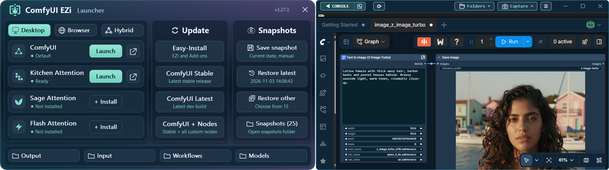

🌍 
<a href="../README.md">English</a> |
<a href="README.zh-CN.md#zh-cn">简体中文</a> |
<a href="README.ja.md#ja">日本語</a> |
<strong>한국어</strong> |
<a href="README.es.md#es">Español</a> |
<a href="README.pt-BR.md#pt-br">Português</a> |
<a href="README.de.md#de">Deutsch</a> |
<a href="README.fr.md#fr">Français</a> |
<a href="README.ru.md#ru">Русский</a> |
<a href="README.tr.md#tr">Türkçe</a> |
<a href="README.vi.md#vi">Tiếng Việt</a>

---

  
  <h1>ComfyUI-Easy-Install</h1>
  

    <strong>클릭 한 번으로 포터블 ComfyUI를 설치하고 EZi Desktop에서 관리하고 설정할 수 있습니다.</strong> 
    Windows • NVIDIA GPUs • Pixaroma Community Edition
  

  <a href="#install">📥 <strong>설치</strong></a> &nbsp;·&nbsp;
  <a href="#features">✨ 기능</a> &nbsp;·&nbsp;
  <a href="#requirements">💻 시스템 요구 사항</a> &nbsp;·&nbsp;
  <a href="#help">🩺 도움말</a> &nbsp;·&nbsp;
  <a href="https://github.com/Tavris1/ComfyUI-Easy-Install/tree/MAC-Linux">🍎 macOS/Linux</a> &nbsp;·&nbsp;
  <a href="https://discord.gg/gggpkVgBf3">💬 Pixaroma Discord</a> &nbsp;·&nbsp;
  <a href="#support">❤️ 후원</a>

 

**EZi가 처음이신가요?** [만화로 보는 EZi](#comic)

## ✨ 기능

**ComfyUI-Easy-Install**은 독립된 Python 환경, 바로 사용할 수 있는 노드와 **EZi Desktop**을 갖춘 포터블 ComfyUI를 설치합니다.

- **원클릭 설치** - Git, Python, PyTorch, ComfyUI와 노드를 자동으로 설정합니다
- **수동 설정 불필요** - Python, ComfyUI와 모델이 한 폴더에 있습니다
- **원클릭 추가 기능** - Nunchaku, SageAttention, FlashAttention, InsightFace 등
- **EZi Desktop** - 스마트 콘솔과 설정 메뉴를 갖춘 전용 창
  - PyTorch/CUDA 버전(Torch-Pack)
  - ComfyUI 및 프런트엔드 버전
  - 모델 폴더 및 Input/Output/User 폴더
  - 시작 인수 및 Dynamic VRAM
  - ComfyUI-Manager 설정 및 패키지 버전 고정
  - UV/PIP 캐시 및 GGUF 변환
- **EZi Launcher** - 시작, 업데이트, 폴더 열기, 스냅샷 저장 및 복원

<b>EZi Desktop에서 할 수 있는 일</b>

- 전용 창, 브라우저 또는 양쪽에서 ComfyUI 실행
- ComfyUI와 EZi의 새 버전 알림 받기
- ComfyUI에서 다운로드한 모델을 적절한 폴더에 저장
- **콘솔**
  - 검색(Ctrl+F) 및 로그를 .txt 파일로 저장(Ctrl+S)
  - 콘솔을 별도 창으로 분리
  - 선택한 텍스트를 복사하거나 저장하고, Google 검색 또는 Claude나 ChatGPT에 질문
- **화면 캡처** - 스크린샷 또는 화면 녹화
- **모델 폴더** - 기존 모델 폴더 여러 개 연결
- **Input, Output, User 폴더 사용자 지정**
- **시작 인수** - 모든 옵션을 확인할 수 있는 편집기
- **ComfyUI-Manager** - 새 UI 또는 기존 UI 선택, 보안 수준 설정, pip 및 Git URL로 설치
- **패키지 버전 관리** - 버전 고정 예시: `numpy==1.26.4`
- **패키지 캐시** - UV/PIP 캐시 유지 또는 정리
- **시스템 정보** - GPU, RAM, Python, Torch, ComfyUI, 긴 경로 지원 상태
- 테마, 글자 크기, 도구 설명 및 콘솔 배경
- Pixaroma 워크플로 및 ComfyUI 강좌 링크

---

## 💻 시스템 요구 사항

| | |
|---|---|
| **운영 체제** | Windows 10 / 11, 64비트 |
| **GPU** | NVIDIA RTX 20 시리즈 이상 |
| **드라이버** | NVIDIA 580 이상 권장 |
| **RAM** | 최소 8GB, 16GB 이상 권장 |
| **디스크** | 최소 15GB의 여유 공간과 모델 저장 공간 필요(SSD 권장) |
| **Internet** | 설치 중 필요 |

> [!NOTE]
> 드라이버 버전이 **580** 미만이면 **CUDA 12.8**과 **Torch 2.8.0**을 설치합니다. **CUDA 13.0**과 **Torch 2.11.0**을 사용하려면 드라이버를 업데이트하세요.

---

## 🖥️ Windows 설치

> [!IMPORTANT]
> - 영문으로 된 짧은 경로를 사용하세요. 예: `D:\AI\`.

1. [**📥 최신 버전 다운로드**](https://github.com/Tavris1/ComfyUI-Easy-Install/releases/latest/download/ComfyUI-Easy-Install.zip)
2. ZIP 파일을 새 폴더에 압축 해제합니다
3. 다음 파일을 실행합니다: **`ComfyUI-Easy-Install.bat`**
4. 설치가 끝날 때까지 기다립니다
5. **Start ComfyUI**를 클릭하거나 바탕 화면의 **ComfyUI-EZi Launcher** 바로 가기를 엽니다

<b>설치되는 구성 요소</b>

| 구성 요소 | 버전 |
|---|---|
| [Git](https://git-scm.com/) | Git이 없을 때만 최신 버전 설치 |
| [Python](https://www.python.org/downloads/release/python-31210/) | 3.12.10 내장 버전, 체크섬 검증 |
| PyTorch | 2.11.0 + CUDA 13.0 또는 2.8.0 + CUDA 12.8 |
| [ComfyUI](https://github.com/Comfy-Org/ComfyUI) | 최신 버전 |
| ComfyUI-Manager, Triton, ONNX Runtime GPU, llama-cpp-python | |
| [포함된 노드](#nodes) | Pixaroma 강좌에 사용되는 노드 |
| 입문 워크플로 | Juggernaut Reborn, Z-Image Turbo |
| 예제 미디어 | 저장 폴더: `ComfyUI\input` |
| ComfyUI-EZi Launcher | 바탕 화면 바로 가기 |

---

## ▶️ ComfyUI 실행

**ComfyUI-EZi Launcher**를 열고 모드를 선택하세요.

- **Desktop** - EZi Desktop 전용 창
- **Browser** - 브라우저와 기존 콘솔
- **Hybrid** - 브라우저와 EZi 콘솔

**KitchenAttention**, **SageAttention** 또는 **FlashAttention**으로 시작할 수 있습니다. Sage와 Flash는 먼저 추가 기능을 설치하세요.

---

## 🧩 추가 기능

추가 기능은 **Add-ons** 폴더에 있으며 대부분 **EZi Desktop > Menu**에서도 찾을 수 있습니다.

| 추가 기능 | 설명 |
|---|---|
| **Easy-Models-Linker** | 기존 **models** 폴더를 사용합니다. **LLM** 및 **llm_gguf**는 제외됩니다. |
| **Easy-System-Checker** | 주요 하드웨어 및 소프트웨어 정보 표시 |
| **Nunchaku** | 설치 대상: [Nunchaku](https://github.com/nunchaku-ai/nunchaku) |
| **SageAttention-Multi** | 설치 대상: [SageAttention](https://github.com/woct0rdho/SageAttention) v2.2.0 및 v3(v3는 RTX 50 전용) |
| **FlashAttention** | 설치 대상: [FlashAttention](https://github.com/Dao-AILab/flash-attention) v2.8.3 |
| **InsightFace** | 설치 대상: [InsightFace](https://github.com/deepinsight/insightface) |
| **Trellis2 + Pixal3D** | 설치 대상: [Trellis 2.0 + Pixal3D @visualbruno](https://github.com/visualbruno/ComfyUI-Trellis2) 및 해당 모델 |
| **Torch-Pack** | PyTorch 및 CUDA 버전 변경 |
| **Easy-model2GGUF** | 모델을 GGUF로 변환(Q2_K~Q8_0) |
| **Long-Paths-Enabler** | Windows 긴 경로 지원 활성화 |
| **Toggle-DynamicVRAM** | 다음 옵션 전환: `--disable-dynamic-vram` |

<b>Torch-Pack 버전 및 추가 기능 지원</b>

| Torch | CUDA | Nunchaku | Sage v2 | Sage v3 | Flash | Trellis2 |
|---|---|:---:|:---:|:---:|:---:|:---:|
| 2.7.1 | 12.8 | ✅ | ✅ | ✅ | ✅ | |
| 2.8.0 | 12.8 | ✅ | ✅ | ✅ | ✅ | ✅ |
| 2.9.1 | 13.0 | ✅ | ✅ | ✅ | ✅ | |
| 2.10.0 | 13.0 | ✅ | ✅ | ✅ | ✅ | |
| **2.11.0** (기본값) | 13.0 | ✅ | ✅ | ✅ | ✅ | |
| 2.12.1 | 13.0 | | ✅ | | ✅ | |
| 2.13.0 | 13.0 | | ✅ | | ✅ | |
| 2.14.1 | 13.0 | | ✅ | | ✅ | |

---

## 🔄 업데이트

실행기에서 ComfyUI, 노드 및 EZi를 업데이트하세요. 큰 변경 전에는 스냅샷을 저장해 두면 클릭 한 번으로 복원할 수 있습니다.

---

## 🩺 문제 해결

<b>설치 프로그램이 중단되거나 오류가 표시됨</b>

- 설치가 중단되면 **Show log**를 누르고 **Copy details**로 복사한 내용을 [Pixaroma Discord](https://discord.gg/gggpkVgBf3)에 붙여 넣으세요.
- 전체 로그는 `ComfyUI-Easy-Install.log`에 있습니다.
- 다시 시도하기 전에 설치가 완료되지 않은 `ComfyUI-Easy-Install` 폴더를 삭제하세요.

<b>Windows 11: "Bad Image" (0xc0e90002)</b>

- Windows 11에서 “Bad Image”(0xc0e90002) 오류가 발생하면 Smart App Control을 끄고 ComfyUI를 다시 시작하세요.
- 신뢰할 수 없는 앱에 대한 보호가 약해지므로 확인하기 전에 Windows 경고를 읽으세요.

<b>파일이 누락되거나 차단됨</b>

- 파일이 누락되면 Windows 보안의 보호 기록에서 Python 파일이 차단되었는지 확인하세요.
- 파일을 허용하고 폴더를 삭제한 뒤 다시 설치하세요.

<b>NVIDIA 드라이버가 감지되지 않음</b>

- 드라이버가 감지되지 않으면 [nvidia.com/drivers](https://www.nvidia.com/drivers)에서 최신 드라이버를 설치하고 터미널에서 `nvidia-smi`가 작동하는지 확인하세요.

<b>경로 또는 사용자 이름에 영문 이외의 문자가 있음</b>

- 설치 프로그램을 `D:\AI\` 같은 경로로 옮기세요.
- Windows 사용자 이름에 영문 이외의 문자가 있으면 문제가 계속될 수 있습니다.

<b>"ComfyUI is already running"</b>

- “ComfyUI is already running”은 같은 포트(기본값 8188)가 사용 중이라는 뜻입니다.
- 다른 ComfyUI 창을 닫고 다시 시도하세요.

<b>긴 파일 경로 오류</b>

- 긴 경로 오류가 발생하면 **Add-ons\Tools**에서 **Long-Paths-Enabler**를 실행하세요.

---

## 🧹 제거

`ComfyUI-Easy-Install` 폴더와 바탕 화면의 **ComfyUI-EZi Launcher** 바로 가기를 삭제하세요.

---

## 📦 포함된 노드

<b>Pixaroma 강좌에 사용되는 노드</b>

| 🖼️ 이미지 | 🎬 비디오 | 🎵 오디오 | 🧩 도구 및 워크플로 | 🤖 모델 |
|---|---|---|---|---|
| [Tiled Diffusion & VAE](https://github.com/shiimizu/ComfyUI-TiledDiffusion) | [VideoHelperSuite](https://github.com/Kosinkadink/ComfyUI-VideoHelperSuite) | [MelBandRoFormer](https://github.com/kijai/ComfyUI-MelBandRoFormer) | [ComfyUI Manager](https://github.com/Comfy-Org/ComfyUI-Manager) | [QwenVL](https://github.com/1038lab/ComfyUI-QwenVL) |
| [Inpaint CropAndStitch](https://github.com/lquesada/ComfyUI-Inpaint-CropAndStitch) | [WanVideoWrapper](https://github.com/kijai/ComfyUI-WanVideoWrapper) | [Qwen3-TTS](https://github.com/flybirdxx/ComfyUI-Qwen-TTS) | [Easy-Use](https://github.com/yolain/ComfyUI-Easy-Use) | [GGUF](https://github.com/city96/ComfyUI-GGUF) |
| [ControlNet Aux](https://github.com/Fannovel16/comfyui_controlnet_aux) | [WanAnimatePreprocess](https://github.com/kijai/ComfyUI-WanAnimatePreprocess) | | [KJNodes](https://github.com/kijai/ComfyUI-KJNodes) | |
| [LayerStyle](https://github.com/chflame163/ComfyUI_LayerStyle) | [SCAIL-Pose](https://github.com/kijai/ComfyUI-SCAIL-Pose) | | [rgthree](https://github.com/rgthree/rgthree-comfy) | |
| [RMBG](https://github.com/1038lab/ComfyUI-RMBG) | [SeedVR2 VideoUpscaler](https://github.com/numz/ComfyUI-SeedVR2_VideoUpscaler) | | [iTools](https://github.com/MohammadAboulEla/ComfyUI-iTools) | |
| [Easy-Sam3](https://github.com/yolain/ComfyUI-Easy-Sam3) | | | [ControlAltAI Nodes](https://github.com/gseth/ControlAltAI-Nodes) | |
| [Krea2Edit](https://github.com/lbouaraba/comfyui-krea2edit) | | | ✨[Pixaroma](https://gitlab.com/pixaroma/ComfyUI-Pixaroma) | |

---

## 🎭 만화로 보는 EZi

EZi가 처음이신가요? 만화의 이미지를 클릭하면 원본 크기로 볼 수 있습니다.

<table width="100%">
  <tr>
    <th width="16.66%">ComfyUI 설치</th>
    <th width="16.66%">EZi 실행기</th>
    <th width="16.66%">모델 재사용</th>
    <th width="16.66%">추가 기능 설치</th>
    <th width="16.66%">업데이트 및 복원</th>
    <th width="16.66%">시스템 정보</th>
  </tr>
  <tr>
    <td align="center"></td>
    <td align="center"></td>
    <td align="center"></td>
    <td align="center"></td>
    <td align="center"></td>
    <td align="center"></td>
  </tr>
</table>

## ❤️ 개발 후원

프로젝트가 마음에 드셨다면 지속적인 개발을 후원해 주세요.

